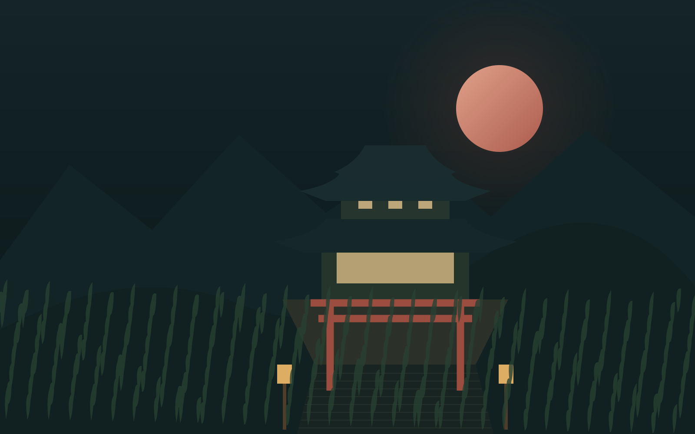

# Quiet Hours

An atmospheric temple experience built around the free ThreeUI Community scene.

Ночной сад: интерактивная 2D-иллюстрация доступна сразу; отдельная 3D-сцена запускается по желанию. Три повторяемых шага показывают, как исходник превращается в атмосферный кадр.



*Original graphic prologue — the live 3D temple is a separate licensed scene.*

## Explore

- [Public demo](https://safal207.github.io/quiet-hours-sanctuary/)
- [Portfolio and learning paths](https://safal207.github.io/test-it-python/ai-path/)
- [Scope, contribution and evidence](PORTFOLIO.md)

## Features

- Immediately usable 2D SVG illustration: brightness, rain overlay, framing and reset
- Three repeatable teaching presets: original → atmosphere → final framing
- Optional lazy WebGL scene with a visible return to 2D
- Three camera viewpoints, real rain/ripple visibility and exposure controls
- Pause, reduced-motion preference and background-tab suspension
- Local Three.js runtime with no CDN or external textures

## Run locally

No package installation, API keys or CDN are required. Serve the static directory:

```bash
python3 -m http.server 8000 --directory dist
```

Open http://localhost:8000. Opening index.html directly as file:// is not supported because the application uses browser modules.

## Validate

```bash
npm run check
```

Checks cover local links, unique HTML IDs, JavaScript syntax and relevant state/export contracts. This is not a browser-rendering certification.

## Scope and limitations

- The base temple world is by Meng To / ThreeUI Community (MIT), not an original Safonov model.
- New contribution: visual identity, responsive page, control API, lifecycle integration, interactive 2D illustration, teaching steps and documentation.
- WebGL is required only for the optional 3D scene. The 2D controls work before loading, during loading and after a WebGL error.
- 2D framing is CSS cropping/scaling of a prepared SVG. It does not reconstruct 3D geometry from an image.
- Device FPS and real-browser rendering have not been measured in this environment.

## Credits and licensing

The renderer is adapted from Meng To / ThreeUI Community, pinned to commit `68802d5428071ada5c20db8094b1649e6bb770ed`. Its MIT notice is preserved in `LICENSE-ThreeUI.txt`. Changes are listed in `PORTFOLIO.md`. Three.js 0.149.0 is vendored with its MIT notice.

Creative direction and implementation: Alexey Safonov, with AI assistance. Code under MIT; preserve all third-party notices. Inspiration: the supplied Meng To visual references. No commercial relationship or endorsement is implied.

## Startup and mobile recovery

Low/touch mode skips HDR bloom. Desktop bloom is gated by half-float render-target support. The canvas stays hidden until a successful first frame, and both initial and later render failures return to the interactive 2D illustration with the current light, rain and framing preserved. Retry remains available. An explicit lightweight start is available. CSS owns canvas dimensions so orientation changes can resize the drawing buffer.

`npm run check` exercises the 2D transformation presets, reset, reduced-motion initialization, changes made while 3D is loading, explicit return to 2D, startup/retry/context loss with a mocked host, GPU capability policy, and real Three scene assembly with mocked drawing. These are regression checks, not real-device GPU or visual certification.

## Repeatable lesson

Open the [three-step lesson](https://safal207.github.io/quiet-hours-sanctuary/#process). Step 1 restores the original: gates, 100% light, no rain. Step 2 applies 130% light and a separate rain layer. Step 3 keeps that atmosphere and focuses on the temple. The result bar states the exact active parameters. Students can build two moods, record their settings and explain the visible difference. The same controls apply to the optional 3D scene, but it is a separately constructed environment, not a conversion of the SVG.


## Lighting regression matrix

The light slider controls exposure between 60% and 140%. Full mode adds bloom and grading; lightweight mode uses direct tone mapping. They share responsive controls, not a promise of identical pixels.

| Check | Action | Expected result | Evidence |
| --- | --- | --- | --- |
| HDR bloom input | Render the full scene | Every sampler receives a texture; no buffer samples itself | Node render-pass contract, passed |
| Bloom accumulation | Upsample all four levels | Additive passes preserve the previous light buffer | Node render-pass contract, passed |
| Shader ramps | Build high and low scenes | Every literal `smoothstep` has increasing edges | Material/shader inspection, passed |
| Low-mode emitters | Change exposure 60 → 100 → 140% | Sky, moon, paper and lantern panes participate in tone mapping | Actual Three material contract, passed; visual comparison required |
| Safe input | Pass 0.6, 1, 1.4, out-of-range and non-finite values | Values stay finite within 0.6–1.4; invalid values reset to 1 | Node API contract, passed |
| Pause + controls | Pause, move the light slider, change camera | Frame updates while the light animation phase remains fixed | Host wiring and actual Three state, passed |
| Resume and hidden tab | Resume after pause; hide/restore; return from browser history | No time jump or false adaptive downscaling | Host and renderer timing contracts, passed |
| Real rendered pixels | Compare 60%, 100%, 140% in high and low; toggle rain; resize | Visible scene, brighter exposure in order, no shader or WebGL errors | Browser/GPU run required; see CI artifacts when available |
| Physical devices | Repeat on Android Chrome/WebView and iOS Safari | Controls, readable scene and stable lighting | Requires real-device verification |

Renderer fixes bind `WebGLRenderTarget.texture` to bloom samplers, disable automatic clearing between additive passes, replace undefined descending GLSL ramps, and include direct-mode emitters in exposure. `setPaused(boolean)` freezes animation time while allowing redraws; `resetTiming()` excludes time spent in a hidden tab from the frame budget. These changes are reliability adaptations to the credited ThreeUI world.
